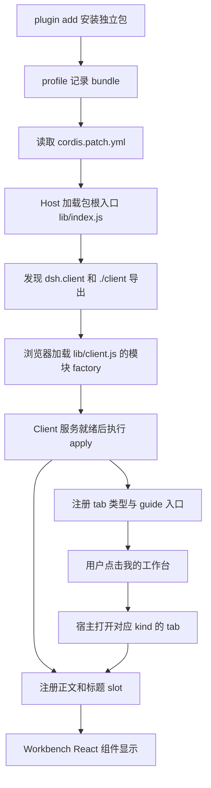

# DSH 右侧栏插件开发教程：以 dsh-sidebar-workbench 为例

本文帮助你从现有示例出发，开发一个可以独立安装、从右侧栏入口打开的 React 页面，并掌握本地加载、调试和交付方法。适合已了解基础 TypeScript、React，但尚不熟悉 Cordis 和 DSH 插件机制的开发者。

本文以 2026-10-24 核对的 DSH `0.2.1-rc.3` 和本插件 `0.1.0` 为基准，使用 Windows PowerShell 命令。插件 API 仍在演进，升级 DSH 时请重新核对类型声明和构建协议。本文讲解的是原生侧栏页面；如果目标只是打开已有网站，应另查内置 Browser 插件。

## 目录

1. [先运行示例](#quick-start)
2. [理解目录和加载链路](#architecture)
3. [掌握核心函数与注册关系](#core-functions)
4. [修改示例并开发自己的插件](#development)
5. [加载、调试与定位故障](#debugging)
6. [测试、打包与卸载](#delivery)
7. [开发速查与后续阅读](#references)

<a id="quick-start"></a>
## 1. 先运行示例

本教程使用两个相邻目录：`E:\deepseek-harness` 是 DSH 主仓库，`E:\dsh-sidebar-workbench` 是独立插件。插件目前通过 `devDependencies` 中的 `link:../deepseek-harness/...` 获取 DSH 的类型与开发依赖，因此移动目录时需要同步调整这些链接。

### 1.1 检查环境并构建插件

要求 Node ≥24.9.0、pnpm 11.28.5。主仓库需要已按其[从源码运行说明](../deepseek-harness/README.zh.md)完成依赖安装与构建；插件类型检查依赖相邻 checkout 已生成的声明文件。已有可运行主仓库时，不必每次修改插件都重建主仓库。

```powershell
node --version
pnpm --version
Set-Location E:\dsh-sidebar-workbench
pnpm install --frozen-lockfile
pnpm run build
pnpm run build:check
```

执行成功后应存在 `lib/index.js`、`lib/client.js` 和 `lib/types/`。`build` 先用 TypeScript 生成声明，再用 tsdown 生成运行产物；`build:check` 检查本包源码、构建配置及 TypeScript 测试。

若本机仍默认使用 Node 22，可以在当前终端临时使用已安装的 Node 24。以下路径是本次开发环境的实际路径，其他电脑请替换成自己的 Node 24 安装目录；每个新终端都要单独设置。

```powershell
$workbenchNodeDir = 'C:\Users\whj0512\.cache\codex-runtimes\codex-primary-runtime\dependencies\node\bin'
if (-not (Test-Path -LiteralPath (Join-Path $workbenchNodeDir 'node.exe'))) {
  throw '请将 workbenchNodeDir 改为本机 Node 24 的安装目录'
}
$env:PATH = "$workbenchNodeDir;" + $env:PATH
node --version
```

### 1.2 建立 Web 开发 profile，链接安装

profile 是一套可启动的插件组合及配置。包目录不等于 profile；安装到某个 profile 后，应使用同一个 profile 启动。

```powershell
Set-Location E:\deepseek-harness
$workbenchHome = if ($env:DSH_HOME) { $env:DSH_HOME } else { Join-Path $env:USERPROFILE '.dsh' }
$workbenchProfile = Join-Path $workbenchHome 'profiles\sidebar-workbench-dev'

if (-not (Test-Path -LiteralPath $workbenchProfile)) {
  pnpm dsh --profile sidebar-workbench-dev --from-default-profile web --dump-config
  if ($LASTEXITCODE -ne 0) { throw 'Web profile 初始化失败' }
}

pnpm dsh plugin --profile sidebar-workbench-dev add E:/dsh-sidebar-workbench
pnpm dsh --profile sidebar-workbench-dev --dump-config |
  Select-String -Pattern 'sidebar-workbench' -Context 1,1
pnpm dsh --profile sidebar-workbench-dev --port 3081
```

`--from-default-profile web` 只用于首次初始化。对已有 profile 再次使用它会重置该 profile 的依赖和用户 patch。也不要仅对一个全新名称执行 `plugin add` 就假定得到了 Web 应用：安装命令创建的基础 profile 不等于从 `web` 模板建立的 profile。

### 1.3 从页面确认成功

打开启动日志给出的完整本地链接，选择工作区进入会话，展开右侧栏，在“开始”页点击“我的工作台”。若侧栏已打开其他内容，先点击 tab 条的“新标签页”。点击“点击试试”后计数增加，点击“重置”后归零，即完成最小链路验证。

这个页面不调用模型，验证计数不需要发送聊天消息。首次启动若弹出账号引导，可关闭后继续验证页面。启动链接可能含本地访问令牌，不要把令牌写进源码或分享出去。

<a id="architecture"></a>
## 2. 理解目录和加载链路

### 2.1 应先阅读哪些文件

| 文件 | 负责什么 | 开发时通常改什么 |
| --- | --- | --- |
| [package.json](package.json) | 包身份、兼容版本、导出、安装层和 Client 元数据 | 新插件包名、依赖、发布文件 |
| [cordis.patch.yml](cordis.patch.yml) | 将包插入 profile 的插件树 | 插件行 `id` 和包名 |
| [src/index.ts](src/index.ts) | Host 侧插件入口 | 纯 UI 插件可保持空 `apply()` |
| [src/client/index.ts](src/client/index.ts) | 浏览器侧依赖和注册装配 | 字典、样式、tab 与 slot 注册 |
| [definition.ts](src/client/components/definition.ts) | 页面类型和开始页入口 | 类型 `kind`、标题、入口顺序和图标 |
| [Workbench.tsx](src/client/app/Workbench.tsx) | 页面正文及临时计数 | 业务 UI、局部状态和操作 |
| [WorkbenchTitle.tsx](src/client/components/WorkbenchTitle.tsx) | tab／浮窗标题 | 标题图标和本地化显示 |
| [locales.ts](src/client/i18n/locales.ts) | 中英文文案及类型扩展 | 标题、提示、按钮和无障碍文案 |
| [Workbench.module.css](src/client/styles/Workbench.module.css) | 页面样式 | 布局和主题变量使用 |
| [tsdown.config.ts](tsdown.config.ts) | Host／Client 打包及 CSS Modules 编译 | 构建模块 ID、共享模块配置 |
| `tsconfig.*.json` | Host、Client、测试检查的编译配置 | 新增文件、类型依赖 |
| `tests/`、`scripts/browser-smoke.mjs` | 单元、产物和真实 Web 验证 | 新业务的行为断言与界面预期 |

### 2.2 从安装到绘制页面



Host 与 Client 的 `apply()` 在不同运行环境执行。Host 是 Node 侧，Client 是浏览器侧；同名的 `ctx` 不是跨进程共享对象。React 页面不能直接调用 Host 的 Node 文件系统等能力。

### 2.3 一个包里为什么要有两种元数据

本包 manifest 的关键部分如下；这是已有文件的节选，不是可以单独覆盖整个 `package.json` 的完整模板。

```json
{
  "name": "dsh-plugin-sidebar-workbench",
  "engines": { "node": ">=24.9.0", "dsh": "0.2.1-rc.3" },
  "exports": {
    ".": { "types": "./lib/types/index.d.ts", "default": "./lib/index.js" },
    "./client": { "types": "./lib/types/client/index.d.ts", "default": "./lib/client.js" },
    "./package.json": "./package.json"
  },
  "dsh": {
    "bundle": { "patch": "./cordis.patch.yml" },
    "client": {
      "platform": "web",
      "inject": [
        "@deepseek-ai/dsh-client-ui-sidebar-right",
        "@deepseek-ai/dsh-client-ui-renderer",
        "@deepseek-ai/dsh-client-locale"
      ]
    }
  }
}
```

`dsh.bundle` 决定安装包贡献哪一层配置；`dsh.client` 告诉宿主这个包还有浏览器端插件。只有浏览器导出而没有被加载的 Host 插件行，不足以完成本例的发现流程；只有 bundle 而没有 Client 元数据，也不会自动注册侧栏页面。

本包的安装层只有一条插入操作：

```yaml
- insert:
    - id: sidebar-workbench
      name: dsh-plugin-sidebar-workbench
```

<a id="core-functions"></a>
## 3. 掌握核心函数与注册关系

### 3.1 `apply(ctx)` 与 `inject`：入口和运行依赖

Host 入口 `src/index.ts` 只有 `export function apply(): void {}`。它不绘制页面，也不提供业务服务，但使包可以作为普通 Cordis 插件挂载。

Client 入口声明：

```ts
export const inject = ['slots', 'locale', 'sidebarRightTabs']
export function apply(ctx: Context): void {
  // 在这里注册本插件提供的内容。
}
```

`inject` 中写的是**服务名**。Cordis 等待这些服务就绪后激活插件：`slots` 用于 UI 插槽，`locale` 用于文案，`sidebarRightTabs` 用于页面类型注册。这里的 `apply` 是插件生命周期入口，不是每次 React 渲染或每次点击入口都会执行的函数。

manifest 的 `dsh.client.inject` 写的是**包名**，不能代替这份服务声明。另一个同名概念 `slots.inject()` 等待的是**具体 slot 的声明**。这三种依赖表达应分别理解。

Client 文件中的 `import type {} from '.../client'` 用于引入 TypeScript 声明合并，让编译器认识 `ctx.locale` 等扩展；它在构建时被擦除，不会替你安装或运行那个插件。运行依赖仍由 profile 和 Cordis 的服务注入提供。

### 3.2 `ctx.effect()`：让注册随插件卸载释放

每一项有生命周期的注册都交给 `ctx.effect()` 管理。其回调执行注册并返回注销器；不要丢掉返回值。

```ts
ctx.effect(
  () => ctx.sidebarRightTabs.register(workbenchDefinition(t)),
  'workbench: page',
)
```

样式的处理展示了普通资源的同一模式：

```ts
ctx.effect(() => {
  const style = document.createElement('style')
  style.dataset.plugin = WORKBENCH_ID
  style.textContent = stylesheet
  document.head.append(style)
  return () => style.remove()
}, 'workbench: stylesheet')
```

如果自行建立定时器、订阅或其他资源，也需要提供对应清理动作。避免在模块顶层写入 DOM 或创建全局共享状态，否则插件重新启用时可能出现重复注册或残留。

### 3.3 `workbenchDefinition(t)` 与 `sidebarRightTabs.register()`：注册“这是什么页面”

`workbenchDefinition` 是本插件自己的辅助函数，不是 DSH 内置 API。它生成传给宿主注册表的静态定义：

```ts
export const WORKBENCH_ID = 'dsh-plugin-sidebar-workbench'
export const WORKBENCH_KIND = 'sidebar-workbench'

export function workbenchDefinition(t: TranslateNS<'sidebarWorkbench'>): SidebarRightTabDefinition {
  return {
    id: WORKBENCH_ID,
    kind: WORKBENCH_KIND,
    priority: 'extension',
    title: () => t('title'),
    guide: [{
      id: 'workbench',
      order: 50,
      title: () => t('title'),
      description: () => t('description'),
      icon: IconCodeOutlineRegular,
    }],
  }
}
```

`kind` 是导航时使用的页面类型名；定义的 `id` 是实现身份，宿主使用它找到正文组件。`guide` 数组贡献开始页入口；没有 `guide` 时，类型仍可注册，但不会自动出现入口。本例不填写 `patterns`，因为它是按类型打开的页面，不负责认领文件资源地址。

`guide` 在当前源码中是数组，复制旧文档里的单对象写法会不匹配。省略 `multiple` 和 `keepMounted` 使用宿主默认行为：不主动声明多实例内容，也不要求正文在隐藏后保活。

### 3.4 `slots.inject()` 与 `slots.register()`：注册“页面画什么”

tab 定义只提供类型信息。正文还必须注册到宿主声明的 keyed slot：

```ts
ctx.effect(() => ctx.slots.inject('sidebar.right.pane.tab', () => ctx.slots.register(
  {
    name: 'sidebar.right.pane.tab',
    key: WORKBENCH_ID,
    locale: 'sidebarWorkbench',
  },
  Workbench,
)), 'workbench: body')
```

`slots.inject(name, callback)` 等待该 slot 真正声明后再执行回调，并跟随其声明生命周期重新装配。只依赖 `slots` 服务不能保证某个具体 slot 已存在，因此不要把跨插件注册简化为不等待声明的直接 `slots.register()`。

`slots.register(options, Component)` 把组件放入指定位置并返回注销器。这里的 `key` 必须等于 tab 定义的 `id`，不是 `kind`。组件不会通过 `ReactDOM.createRoot()` 单独挂到页面，渲染由宿主完成。

标题使用同一实现 ID 注册到 `sidebar.right.pane.tab.title`。本例的 `WorkbenchTitle({ t })` 通过 locale seat 渲染标题，已打开的 tab 也能跟随语言变化；只有定义里的 `title(address)` 时，文本是在打开时捕获的。

### 3.5 `locale.register()`、`locale.bind()` 与 `t()`：类型化文案

本例先注册字典，再获得该命名空间的翻译函数：

```ts
const namespace = 'sidebarWorkbench'
ctx.effect(() => ctx.locale.register(namespace, { zh, en }), 'workbench: dictionaries')
const t = ctx.locale.bind(namespace)
```

在 `locales.ts` 中，`LocaleNamespaceMap` 声明合并把 `sidebarWorkbench` 对应到中文词典的键集合；英文词典用 `satisfies Record<keyof typeof zh, string>` 检查键的一致性。

注册组件时填写 `locale: namespace`，框架就提供 `t` prop。组件使用 `PropsLocale<'sidebarWorkbench'>` 派生其类型，并通过 `t('count', { count })` 插值。按钮、提示、标题和 `aria-label` 都从字典取值；代码中的稳定 ID 不随语言变化。

### 3.6 `Workbench()`、`useState()`：实现页面业务

`Workbench` 是普通 React 函数组件，本例只需要框架提供的翻译函数和本地计数：

```tsx
export function Workbench({ t }: PropsLocale<'sidebarWorkbench'>): ReactNode {
  const [count, setCount] = useState(0)
  // 完整 JSX 见 Workbench.tsx。
}
```

计数增加使用 `setCount(value => value + 1)`，重置使用 `setCount(0)`。页面自身不拿 `ctx`，也不直接访问其他插件的服务对象。将来需要服务操作时，应在插件注册处把普通数据和回调注入组件。

这份状态只属于当前挂载的组件。关闭重开、刷新或其他导致卸载的操作会归零。若需要跨重挂载保留状态，下一步应学习 Slot store；若需要跨应用重启保留数据，还需要明确持久化方案。单纯 UI 状态不必写入模型的 Session 日志。

### 3.7 `sidebarRight.openTab()` 与 `useTabInfo()`：进阶导航

本例的开始页入口已经由宿主导航，无需再手动实现点击事件。若将来在其他 Client 入口主动打开工作台，可以在已注入 `sidebarRight` 的插件作用域中调用 `ctx.sidebarRight.openTab('sidebar-workbench')`；它要求当前存在已挂载的会话侧栏。

如果动作发起于某个 tab 正文，优先从框架提供的 `useTabInfo()` 获取 `tab.actions.openTab`，让动作绑定到该 tab 所属会话。对应组件输入通过 `PropsRuntime<'sidebar.right.pane.tab'>` 派生。当前 Workbench 没有使用这两项导航能力，不需要为了展示静态页面提前增加依赖。

### 3.8 必须对应的标识速查

| 标识 | 本例取值 | 必须与哪里对应 |
| --- | --- | --- |
| npm 包名 | `dsh-plugin-sidebar-workbench` | patch 的 `name`、构建 factory 的模块 ID |
| tab 实现 `id` | `dsh-plugin-sidebar-workbench` | 正文与标题注册的 `key`；使用包名是本例的约定 |
| tab `kind` | `sidebar-workbench` | 主动导航时 `openTab()` 的参数 |
| patch 行 `id` | `sidebar-workbench` | profile 层覆盖、禁用时定位的行；与 tab `kind` 相同只是本例命名选择 |
| locale 命名空间 | `sidebarWorkbench` | 字典类型扩展、字典注册、slot `locale`、组件 `PropsLocale` |
| guide 入口 `id` | `workbench` | 该类型内部的入口身份 |
| profile 名 | `sidebar-workbench-dev` | 安装、启动、卸载命令中保持相同 |

<a id="development"></a>
## 4. 修改示例并开发自己的插件

### 4.1 先完成一次小改动

建议先在现有包中把标题改为自己的业务名称：在 `locales.ts` 中同时修改 `zh.title` 和 `en.title`，构建、重启 Host 并刷新浏览器，确认开始页入口、正文标题和 tab 标题都更新。只改显示标题时无需修改任何注册 ID。

接着在 `Workbench.tsx` 中加入一项业务交互。只对该组件有意义的临时输入放入 `useState`；新按钮、表单标签与提示先添加字典键，再使用 `t()`。复用 `@deepseek-ai/dsh-client-ui-primitives` 的控件，不要把另一业务插件的 React 组件直接作为运行时依赖导入。

样式写入本包 CSS Modules，使用 `--dsw-alias-label-primary` 等宿主主题变量。修改后同时检查明暗主题、窄侧栏、长标题换行和键盘可达性。

### 4.2 从本例建立另一个独立包

例如创建 `E:\dsh-task-board`，包名使用 `dsh-plugin-task-board`。这是供你日后执行的改造练习，本文没有创建第二个插件。

1. 复制 `src/`、`tests/`、`scripts/`、manifest、patch、`tsconfig*.json`、`tsdown.config.ts`、`vitest.config.ts`、`.gitignore` 和许可证作为起点。不要复制 `node_modules/`、`lib/`、`artifacts/`、`.dsh-test-home/` 或旧 tarball。
2. 将包名更新为 `dsh-plugin-task-board`，同步修改 patch 的 `name`、`WORKBENCH_ID` 的值和 `tsdown.config.ts` 中的 `id`。可将常量名改为更贴合业务的名称，但所有引用需要同步。
3. 将类型改为 `task-board`，使用自己的 patch 行 ID，并把 locale 命名空间改为 `sidebarTaskBoard`。命名空间的类型声明、注册处与 `PropsLocale` 必须同时更新。
4. 修改开始页文案、图标和页面组件，移除或替换计数逻辑；删除不用的依赖前先检查构建和类型引用。
5. 更新测试中的包名、类型、字典及 UI 预期。浏览器脚本还包含工作区名称、按钮名称、入口匹配和样式标记，不能原样拿来验证新业务。
6. 在新目录执行 `pnpm install` 生成自己的 lockfile，再执行构建、类型检查及测试。修改过依赖后先更新 lockfile，后续复现才使用 `--frozen-lockfile`。
7. 使用新的开发 profile 名，并按第 1 节从 Web 模板初始化后安装，避免覆盖正在使用的工作台插件。

新包若仍与 `deepseek-harness` 位于同一父目录，现有开发依赖链接可以继续指向它。换到其他目录结构时，要逐项修改 `devDependencies` 的链接目标。不要用 `workspace:*` 替代这些链接：独立包并没有自动成为 DSH monorepo 的 workspace 成员。

### 4.3 为什么不能直接换成普通 Vite 构建

本例 Client 产物不是独立站点的 `index.html`，也不是让浏览器直接执行的普通 Node CommonJS 文件。`tsdown.config.ts` 将 bundle 包进 DSH 的模块 factory 协议：

```js
window.__ModuleLoader__.load({
  id: 'dsh-plugin-sidebar-workbench',
  factory: (require) => {
    var module = { exports: {} }
    var exports = module.exports
    // 浏览器 bundle：从宿主模块表取得 React 等共享模块。
    return module.exports
  },
})
```

这段是协议示意，实际代码由构建器生成，不能用它覆盖产物。`require` 来自 DSH 浏览器模块表，不是 Node 的 `require`；Host 源码仍使用 ESM。共享 React、JSX runtime 和 UI primitives 被 `deps.neverBundle` 外置，避免插件私有 React 副本引起 hook 错误。

CSS 构建也有两种用途：`import css from './Workbench.module.css'` 获取哈希类名映射；`import stylesheet from './Workbench.module.css?inline'` 获取同一份样式对应的 CSS 文本，由 `ctx.effect()` 注入并清理。自定义 CSS 插件使用 `.mjs` 虚拟模块后缀，避免已转换的内容又被当成原始 CSS 处理。两个分支必须保持一致，否则可能出现有类名却无匹配样式的问题。

不要将其他 feature 插件简单加入 `neverBundle`，就认为能从浏览器模块表取得其组件。跨业务插件行为应通过注入服务协作，UI 应通过 slot 组合；新增共享模块需求需要核对 DSH 的 Client 模块规则。

<a id="debugging"></a>
## 5. 加载、调试与定位故障

### 5.1 推荐的双终端开发循环

终端 A 在插件目录构建并监听；终端 B 在 DSH 主仓库运行已安装该插件的 profile。两个终端都必须使用满足版本要求的 Node。

```powershell
# 终端 A
Set-Location E:\dsh-sidebar-workbench
pnpm run build
pnpm run watch
```

```powershell
# 终端 B
Set-Location E:\deepseek-harness
pnpm dsh --profile sidebar-workbench-dev --port 3081 --no-open
```

编辑后，先确认终端 A 已重新生成 bundle，再在终端 B 用 Ctrl+C 停止并重启 Host，最后刷新浏览器。每次重启后使用新的启动链接。本教程用这条明确的刷新路径验收，不依赖热更新。

链接安装保留源码目录链接，但浏览器仍读取该目录里的 `lib/client.js`。只保存 `.tsx` 而未构建，不会改变已交付给浏览器的代码。`watch` 只运行 tsdown，不代替完整类型检查；完成一轮修改后再执行 `build` 和 `build:check`。

### 5.2 分层定位：配置 → 产物 → 注册 → 渲染

**先查配置。** `--dump-config` 可以确认安装层和插件行是否进入当前组合，但不会证明 Client 已成功执行。若完全看不到插件，先核对 profile 名和 `DSH_HOME`，再看 `dsh.bundle` 以及 patch 的包名。

```powershell
Set-Location E:\deepseek-harness
pnpm dsh --profile sidebar-workbench-dev --dump-config |
  Select-String -Pattern 'sidebar-workbench' -Context 1,1
```

**再查产物。** 检查构建时间并运行协议测试。该测试能发现意外打入 React、错误模块请求、模块 ID 不匹配和本机绝对路径残留等问题，但不能替代真实浏览器测试。

```powershell
Set-Location E:\dsh-sidebar-workbench
Get-Item lib/index.js, lib/client.js | Select-Object Name, Length, LastWriteTime
pnpm run test:artifact
```

**再查 Client 注册。** 临时在 `src/client/index.ts` 的 `apply` 中加入 `console.debug('[sidebar-workbench] client apply')`，重建后到浏览器 Console 查看。它应在浏览器端出现；Host 入口的日志则出现在启动终端。不要打印凭据或整份上下文对象，定位完成后移除临时日志。

**最后查渲染。** 在浏览器 F12 的 Network 中过滤 `/plugins`，查找包含该包的 Client 资源请求。DSH 可能通过 combo URL 合并提供多个插件，URL 不一定只是 `/plugins/包名/client.js`。检查返回的是 JavaScript 而非错误页，再看 Console 是否有加载、缺失服务或 React 错误。

当前构建开启压缩且关闭 source map，DevTools 不会自动提供原始 `.tsx` 调试体验。可以在 Sources 中格式化实际返回的 `client.js` 后设置断点，并结合临时日志定位；单独安装 React DevTools 也不能替代插件加载链路检查。

### 5.3 常见问题速查

| 现象 | 优先检查 | 处理方法 |
| --- | --- | --- |
| Node／打包工具启动报错 | `node --version` 与当前终端 PATH | 切换到 Node 24.9+，再重新执行失败命令 |
| 找不到 DSH 类型声明 | 相邻 checkout 的链接目标和已生成声明 | 完成主仓库准备；修正开发依赖路径 |
| 安装成功，但 profile 没有 Web 页面 | 是否从 `web` 模板建立 | 使用新的 Web 测试 profile，不随意重置已有配置 |
| 配置里没有插件行 | 安装／启动的 profile 与 home 是否相同 | 统一 `DSH_HOME` 和 profile 名；检查 bundle patch |
| 配置有插件，浏览器没有加载它 | `dsh.client`、`./client` 和 `lib/client.js` | 核对 manifest 与构建产物，检查 Host 日志 |
| 已加载，但开始页没有入口 | Client `inject`、`guide` 数组、当前会话 | 查服务依赖与注册；确保已进入会话并打开开始页 |
| 有入口，点击后无法显示内容 | tab `id` 与正文 slot `key` | 修正对应关系；保留 `slots.inject()` 声明等待 |
| 正文有内容，但没有样式 | `.module.css` 与 `?inline` 两个构建分支 | 检查 `style[data-plugin="dsh-plugin-sidebar-workbench"]` 及 CSS 类名 |
| 修改后仍然是旧页面 | bundle 时间、安装的是 link 还是旧 tarball | 重新构建；重启正确 profile；刷新页面 |
| 切 tab 后计数归零 | 状态是否在 `useState` 中 | 本例预期如此；需保留时设计 Slot store，而不是直接写全局变量 |
| React invalid hook call | 是否打包了额外 React，是否共享同一实例 | 检查 Client 外置配置与产物测试 |
| 关闭最后一个 tab 后整栏消失 | 宿主的关闭行为 | 再次展开右侧栏，从开始页重开 |
| 新插件仍显示旧名称／测试找不到按钮 | locale、测试脚本、命名空间是否遗漏 | 按标识表逐项核对并更新预期 |
| 浏览器测试卡在账号向导或工作区选择 | 采用的 profile、工作区和首次启动状态 | 按下节准备测试环境；不需要发送模型消息 |

<a id="delivery"></a>
## 6. 测试、打包与卸载

### 6.1 从组件测试走到真实应用

以下是本包的验证层次；新增业务时应更新对应层的断言，不要只以“构建成功”判断页面可用。

| 命令 | 覆盖内容 | 不代表什么 |
| --- | --- | --- |
| `pnpm run build` | 声明与 Host／Client 产物生成 | 不证明宿主能装配并显示页面 |
| `pnpm run build:check` | 源码、构建配置、TS 测试的类型检查 | 不执行组件交互 |
| `pnpm test` | 计数、语言、重挂载、Cordis 清理与 UI 文案快照 | 不是真实浏览器的完整 Slot 装配 |
| `pnpm run test:artifact` | 已生成的 factory 和 Host 导出可加载，共享模块请求受控 | 不验证视觉布局 |
| `pnpm run test:browser` | 真实 Web 入口、交互、主题、窄屏与会话切换 | 不覆盖 Desktop 或模型服务 |

修改文案后，先确认变化符合需求，再更新对应快照并审阅差异；不要为消除测试失败而无条件接受所有新预期。当前工作台的既有测试结果见 [VALIDATION.md](VALIDATION.md)。本文编写阶段重新核对了源码和文档，未重新执行安装、重置 profile 或整套 UI 验收。

### 6.2 运行真实 Web 冒烟测试

使用专门的测试 profile 最容易避免测试状态影响日常使用。该 profile 需要已有名为 `dsh-sidebar-workbench` 的工作区以及默认工作区；已有示例脚本会选择并切换它们。测试以空会话操作页面，不发送模型请求。首次选择目录时，使用插件项目目录。

在主仓库启动实际 Host，按仓库要求带上页面内目录选择器 overlay：

```powershell
Set-Location E:\deepseek-harness
pnpm dsh --profile sidebar-workbench-dev --patch apps/web/tests/pin-browse-picker.overlay.yml --port 3081 --no-open
```

在另一个终端运行：

```powershell
Set-Location E:\dsh-sidebar-workbench
$env:DSH_TEST_URL = '<刚才启动日志中的完整本地 URL>'
pnpm run test:browser
Remove-Item Env:DSH_TEST_URL
```

脚本使用本机 Edge 或 Chrome；若位于其他位置，用 `DSH_BROWSER_PATH` 指定可执行文件。它会保存 `artifacts/browser-results.json` 和截图，检查中英文、1440×1000 与 390×844 视口、明暗主题及交互。390px 场景使用宿主侧栏全屏模式。复制为新插件后，需要同步修改脚本里的工作区和 UI 选择器。

若要隔离测试数据，可在**所有相关终端**统一设置 `DSH_HOME` 为独立目录，然后在该 home 中重新建立测试 profile、安装插件并准备工作区。只更改其中一个终端会导致“安装在 A，启动却用 B”的情况。

### 6.3 打包交付

```powershell
Set-Location E:\dsh-sidebar-workbench
pnpm run build
pnpm run build:check
pnpm test
pnpm run test:artifact
pnpm pack
```

当前版本生成 `dsh-plugin-sidebar-workbench-0.1.0.tgz`。`pnpm pack` 本身不会重建或执行测试，必须先确认 `lib/` 是本次修改后的产物。manifest 的 `files` 决定发布内容；本例只发布必要运行产物、类型、patch、manifest、README 和许可证。

教程、新增源码或测试文件不会因为放在目录里就自动进入 tarball。本文作为本地开发资料保存，当前发布清单未包含它。安装用户只需要构建好的 tarball；继续修改源码的开发者则需要完整工程及其开发依赖。

在已准备的 Web profile 中安装构建包：

```powershell
Set-Location E:\deepseek-harness
pnpm dsh plugin --profile sidebar-workbench-dev add E:/dsh-sidebar-workbench/dsh-plugin-sidebar-workbench-0.1.0.tgz
```

用 tarball 替换 link 安装后，继续修改原源码目录不会更新该安装副本。回到开发流程时重新用源码目录执行 `plugin add`。正式发新版本时更新 manifest 版本号、重新构建和打包，并保留旧包供回退。

### 6.4 卸载与清理验证

停止该 profile 的 Host，再执行：

```powershell
Set-Location E:\deepseek-harness
pnpm dsh plugin --profile sidebar-workbench-dev remove dsh-plugin-sidebar-workbench
pnpm dsh --profile sidebar-workbench-dev --dump-config |
  Select-String -Pattern 'dsh-plugin-sidebar-workbench'
```

重新启动 Host 并打开页面，开始页不应再有工作台入口。已有布局记录的处理由宿主负责，插件无需删除其他会话或工作区。更新 `DSH_TEST_URL` 为重启后的实际地址后，还可执行 `pnpm run test:browser -- --uninstalled` 检查入口和样式是否消失。

<a id="references"></a>
## 7. 开发速查与后续阅读

每次开发时沿着这条顺序检查：先确定插件包名和目标 profile，再对应 tab `id`／slot `key`，然后完成页面与字典，构建并检查产物，最后从真实侧栏入口验证交互。

提交或交付前确认：

- 包名、factory ID、tab 实现 ID、slot key、locale 命名空间都已正确对应；没有误用 `kind` 作为本例的 slot key。
- Host 与 Client 职责分开，组件不直接获取 `ctx`；跨插件行为通过服务、UI 通过 slot 协作。
- 注册和副作用均能释放；纯 UI 状态没有无必要地进入模型日志。
- 页面文案类型完整、控件可通过键盘使用、窄侧栏与明暗主题可读。
- 源码修改后已生成新的运行产物，打包内容足以在独立 Web profile 中加载。
- 验证结果区分组件测试、产物检查、实际 Web 加载与尚未覆盖的平台。

需要扩展时按问题查阅以下本地资料；它们位于相邻 DSH checkout，目录移动后需调整链接。

| 需求 | 资料 |
| --- | --- |
| 理解 Cordis 插件与生命周期 | [第一个插件](../deepseek-harness/docs/user/develop/basic/index.zh.md)、[Cordis primer](../deepseek-harness/docs/cordis-primer.md) |
| 理解 bundle、profile 和安装层 | [打包与安装插件](../deepseek-harness/docs/user/develop/basic/publish.zh.md) |
| 查 tab、导航和生命周期 | [右侧栏子系统](../deepseek-harness/docs/subsystems/sidebar-right.zh.md)、[当前 tab 类型源码](../deepseek-harness/packages/client/ui-sidebar-right/src/client/tab-registry.ts) |
| 需要 Slot store、框架 props 和注入 | [Slots 参考](../deepseek-harness/docs/subsystems/slots.zh.md)、[Client 开发规则](../deepseek-harness/packages/client/AGENTS.md) |
| 排查 Client bundle 和模块请求 | [Client 模块](../deepseek-harness/docs/subsystems/client-modules.zh.md)、[主仓库构建配置](../deepseek-harness/packages/client/tsdown.client.ts) |
| 选择共用控件与主题变量 | [UI primitives](../deepseek-harness/packages/client/ui-primitives/README.md)、[样式规范](../deepseek-harness/docs/web-styling.md) |

## 开发备注

本教程聚焦独立的 Web 右侧栏页面。Host Remote API、文件资源查看器、长期业务数据持久化和 Desktop 专属能力需要分别设计，不属于当前计数示例的实现范围。
