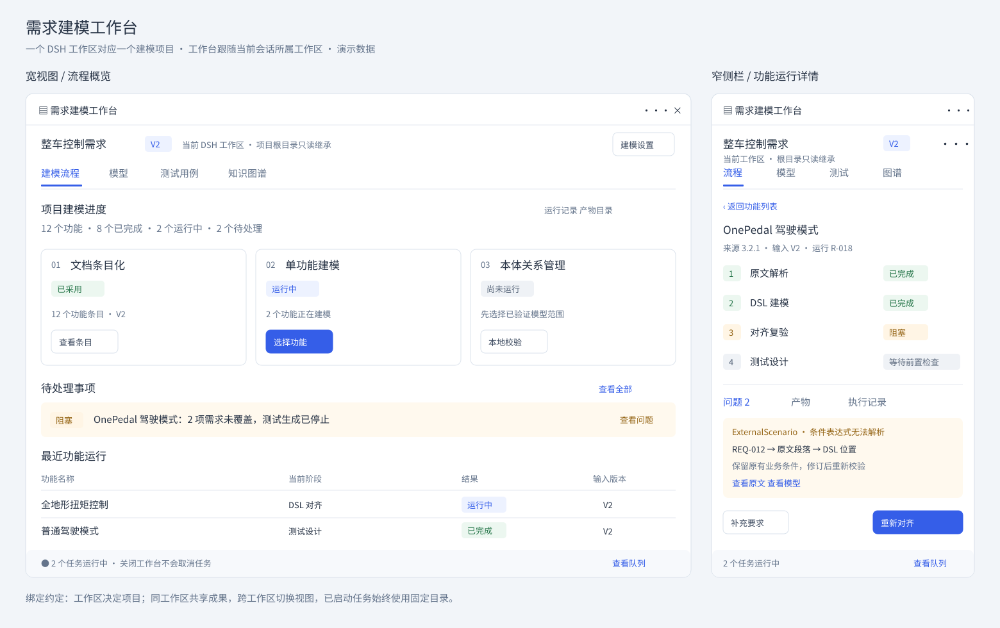

# 三条流水线界面与交互规范

## 摘要

页面采用与 DSH 一致的浅色/深色工程工作台风格：中性背景、轻量分隔、单一主操作、可检查的状态和证据。常用操作在窄侧栏完成；模型、差异和图谱利用宿主已有扩展空间，不创建独立应用壳层。

业务范围与编排规则见[整体方案](三条流水线集成方案.md)。本文件定义待实现的交互，不代表已完成浏览器验证。

## 目录

- [1. 页面框架与视觉参考](#1-页面框架与视觉参考)
- [2. 页面规格](#2-页面规格)
- [3. 共享交互](#3-共享交互)
- [4. 视觉系统](#4-视觉系统)
- [5. 响应式与可访问性](#5-响应式与可访问性)
- [6. 页面状态文案](#6-页面状态文案)

## 1. 页面框架与视觉参考



上图是设计示意，内容均为演示数据；颜色仅用于传达层次，产品代码必须使用宿主语义 token。图中宽视图仍是同一个工作台页面，可由宿主现有分栏或浮动布局承载，不要求改变主聊天区。

从上至下固定四层：工作区与版本栏、一级页签、页面正文、当前项目运行摘要。顶部展示当前会话所属的 DSH 工作区名称、项目版本及建模菜单，根目录在详情中只读展示；不提供独立项目选择器或项目根目录输入框。正文顶部放页面标题和主操作；运行摘要只在当前项目有活跃任务或待处理结果时出现。对话保持在主聊天区，工作台不嵌套第二个聊天窗口。

窄侧栏中一级页签使用紧凑文字标签“流程、模型、测试、图谱”，辅助说明与可访问性名称使用完整名称。建模设置、工作区目录详情、版本管理、运行历史、产物目录放入清晰标记的“更多”菜单；菜单打开后名称完整可见。工作区的选择、创建、改名和移除沿用 DSH 入口，建模设置仅管理材料、版本及业务配置。

## 2. 页面规格

各页使用稳定页面 ID 供路由状态和测试定位；ID 不显示给用户。运行详情、产物预览和差异页都是工作台内部视图状态，首版不承诺可独立访问的浏览器 URL。

### P00 工作区绑定与项目初始化

| 区域 | 内容与行为 |
|---|---|
| 工作区尚未同步 | 显示加载状态或连接错误，不能当成“尚未初始化”开放新建 |
| 会话无工作区归属 | 显示“先在 DSH 中选择工作区并打开其会话”；提供可用的宿主导航入口或明确操作说明，不自动选择最近项目 |
| 已有工作区，尚无项目 | 显示工作区名称和只读根目录、“在当前工作区初始化”“识别当前目录已有成果”；不显示无意义的零统计 |
| 初始化材料 | 标题继承工作区名称；选择原始 DOCX/PDF、MinerU Markdown、文档版本、目标与限制；根目录不可编辑，输出位置展示为工作区内的运行目录 |
| 版本确认 | 显示文件名与可展开完整 Host 路径；让用户声明原文与 Markdown 同版，未做内容核验时仍显示“内容一致性待核验” |
| 预检 | 工作区可访问、目录可用、项目身份与唯一绑定、文件可读、格式、输出范围及已有成果；问题定位到字段或绑定摘要 |
| 识别成果 | 只读扫描当前根目录，按“已识别、缺失、格式不支持”展示；确认采用后登记插件元数据，不移动源文件、不自动运行 |
| 已有项目清单 | 正常绑定则进入项目；登记已变化则进入重新关联核对页，显示旧/新工作区、项目 ID、根目录与未终结运行；冲突或未知运行阻止关联 |
| 主操作 | 初始化使用“初始化并进入条目化”；识别使用“采用识别结果”；重新关联使用“确认关联当前工作区”；成功后进入 P01 |

Host 路径不是浏览器本地路径。材料选择使用宿主资源能力；能力缺失时可提供材料路径输入及 Host 侧校验，但不能补出可编辑项目根目录。工作区外材料的只读引用或复制导入必须显示来源和处理方式，不改原件。使用其他目录的项目应先在 DSH 登记该目录并打开其会话，工作台不从任意外部目录直接切换项目。表单自动补全不能隐式选择 GraphDB 仓库或授权操作。

初始化期间切换到另一工作区时，请求仍绑定原工作区；返回结果只更新原项目，不使目标页面跳回。各工作区保留各自表单草稿；完成提示带工作区名称。重复点击初始化不创建第二个项目，检测到已存在的项目时进入该项目或显示身份冲突。

### P01 建模流程概览

上方是一行项目版本摘要，中部为三张按顺序排列的阶段卡片，下方为“待处理事项”和最近功能运行。每张卡展示阶段名、必要输入、可复用产物数、状态摘要、一个主操作和“查看详情”。窄栏竖向排列，宽栏可横向排列；流程关系不依赖连线颜色表达。

| 阶段 | 主操作随状态变化 | 关键摘要 |
|---|---|---|
| 01 文档条目化 | 准备材料 / 开始条目化 / 审核划分 / 查看条目 | 当前基线、功能数量、概述和关系证据检查 |
| 02 单功能建模 | 选择功能 / 查看运行 / 处理问题 / 查看模型 | 已完成、运行中、待处理；不得只显示总体百分比 |
| 03 本体关系管理 | 本地校验 / 查看校验 / 打开图谱 | 已纳入功能范围、TTL 状态、远端版本；上传不是自动下一步 |

下一步推荐必须解释具体原因，例如“3 个功能已通过对齐，可生成测试”。不存在唯一下一步时显示两项有名称的可选操作，不自动代用户执行。流水线被阻塞时保留卡片与产物入口，不将页面替换成错误屏。

### P02 条目划分与差异审核

页面包含“概述、功能条目、关系种子、校验问题”四个局部视图。条目表显示功能名、来源章节、条目文件、校验状态；点击条目展示原文定位与切分内容。关系种子显示起点、终点、includes 和证据，不把目录树缩进当成业务包含关系。

主操作为“采用划分”；若必需检查未通过则不可用，并列出阻塞项。“调整划分”打开意见输入，支持按条目说明合并/拆分意图，创建新的候选运行。页面不直接拖动目录或改原文。

新版本模式增加“当前基线 / 候选版本”选择器和差异分类。新增、删除、改名、内容变化、关系变化、需匹配分别列出；每项可打开详细差异。默认窄栏顺序显示旧值、新值，宽栏并排；采用时显示受影响功能与产物清单。被删除功能在历史版本仍可查看。

### P03 功能列表与批量运行

搜索、状态筛选和多选工具条位于列表上方。每个功能行显示名称、来源章节、当前阶段、校验/过期标记和最近更新时间；主名称允许换行。窄栏用两行列表，宽栏用紧凑表格；两者共用同一数据和选择状态。

选中后出现“完整建模”主操作，其他操作放在“选择运行方式”菜单：检查关系、对齐复验、仅生成测试。提交前展示运行方式、选中范围、输入版本、可运行数量、阻塞项和并发上限；不得对已失败的前置条件提供“强制继续”。

用户启动批次后留在功能列表，底部出现当前项目队列摘要，可点击进入 P04。重新打开列表时保留当前筛选；切换到另一工作区的会话后，不得携带原项目勾选项或混入原项目队列。返回原工作区后可继续查看原运行。

### P04 功能与运行详情

```text
< 返回功能列表       OnePedal 驾驶模式
来源：3.2.1   输入版本：V2   运行：R-018

原文解析  已完成
DSL 建模  已完成
对齐复验  阻塞 · 2 个问题
测试设计  未开始 · 等待对齐通过

[问题] [产物] [执行记录]
ExternalScenario · 条件表达式无法解析
需求 REQ-012 → 原文段落 → DSL 位置
[查看原文] [查看模型]

[补充要求]                 [重新对齐]
```

步骤状态必须来自编排器。问题区域优先显示会阻断下一阶段的项，展开后显示证据、所属需求/文件位置、修订建议及未解决项。产物区按阶段分组，执行记录显示开始、停止、校验和提交结果；模型详细思考文本不作为标准进度视图。

“查看关联对话”切到该运行关联的 Session；只在能力已核实并存在引用时出现可操作入口。取消按钮明确作用于当前功能还是整个批次；取消完成前不显示“重试”。

### P05 模型视图

选择功能后，局部导航显示 Environment、ExternalScenario、Statechart、DialogMap。首版提供源文件只读预览、需求映射、对齐问题和修订记录；没有专用渲染器时显示可阅读文本和打开文件入口。

宽视图左侧为需求/原文，中间为模型预览，右侧为问题及证据；窄栏使用“模型 / 原文 / 问题”切换同一条选中记录。点击 `requirement_id` 应定位关联原文、DSL 和覆盖信息；无定位数据明确显示未提供。

“模型编辑”保留为后续能力：当前只提供“提交修订要求”和“查看修订差异”。不能放置可编辑文本框后把未校验内容立即作为正式 DSL。后续编辑器接入需另行定义草稿保存、校验、采用和版本失效规则。

### P06 测试用例视图

页首显示功能、输入模型版本、测试产物版本及有效性。提供“用例、覆盖映射、未覆盖项”三个局部视图；用例表的稳定信息为用例标识、关联需求、条件、操作、预期断言与追溯入口，实际列名以真实生成格式适配。

首版无 Excel 渲染能力时，提供映射 JSON 的表格化预览和 Excel 打开/下载入口，不伪造从 Excel 解析出来的数据。覆盖率显示明确分母，例如“可测试需求 18 项，已覆盖 16 项”，不可测试项独立显示理由；分母未知时不计算比例。

“重新生成测试”仅在当前模型通过全部前置检查时可执行；否则页面显示阻塞清单和“前往模型问题”。历史 Excel 仍可打开，但醒目标记其所属旧版本，不能当作当前版本导出。

### P07 知识图谱视图

页首首先选择数据来源：“本地项目关系 / GraphDB 已有关系 / 推理结果”，同时显示项目版本或目标仓库。关系列表是必备视图，图视图是增强展示；在窄栏和图渲染不可用时仍能完成查询、筛选、证据检查及导出。

| 区域 | 交互规范 |
|---|---|
| 范围与筛选 | 项目版本、功能、关系类型、原文事实/推理结果；只查询选定项目范围 |
| 关系列表 | 起点 → 关系 → 终点、来源类型、证据可用性；置信度缺失不补数值 |
| 图视图 | 默认聚焦选中功能的一阶邻域；搜索、缩放、重置和图例；更大范围由用户展开 |
| 证据详情 | 原文摘录/位置、对应模型、推理依据；推理关系保留 `relationSource`、`relationTarget`、`isInferred`、`subtype`、`evidence` |
| 本地成果 | TTL、转换统计、校验报告、纳入范围及排除项 |
| 远端成果 | 上传回执、三元组数量、中文标签抽样、SHACL 状态、推理报告 |

“本地校验”“追加上传”“依赖与冲突分析”“查询/导出”明确分开。上传或推理不可由切换页签、选择仓库、打开关系详情等浏览行为触发。大图默认展示局部范围和总量提示，不把成千节点一次挤入侧栏；加载上限和分页由配置/能力声明控制。

### P08 远端操作确认

在用户主动发起追加上传或推理后显示确认页：操作名称、项目与版本、目标地址/仓库、输入产物、验证摘要、作用范围、明确排除项以及取消/确认按钮。确认按钮使用“确认追加到 requirement”或“确认在 requirement 执行推理”一类具体文案。

追加上传明确提示“仅追加本次 ABox；不清库、不覆盖 TBox/SHACL、不执行推理”。推理显示 ABox/TBox/SHACL 的准备状态与核验时间。目标或产物改变后重新展示确认内容；有效授权范围未变化时不重复询问。凭据值不在确认页、URL、日志或导出文件中出现。

## 3. 共享交互

### 3.1 产物预览

产物入口统一展示名称、类型、版本、生产运行、有效性和检查结果。Markdown/JSON/文本优先复用宿主预览；不支持的格式提供打开或下载。文件打开失败在原入口旁提供原因和重试，不能留下无响应链接。

原文引用必须带文件及可用定位信息。路径完整内容可通过详情或复制获取；仅展示文件名时不能造成两个同名文件无法区分。源码和 diff 保持列结构，在自身容器横向滚动；整页不出现横向滚动。

### 3.2 页面跳转与返回

使用同一工作台内的结构化导航状态：页面、宿主解析的工作区/项目、基线、功能、运行、产物引用。工作区与项目身份由当前 Session 归属决定，不是可独立修改的导航选择。进入详情保存父页面筛选与滚动位置，返回后恢复。未提交意见保留为草稿并显示归属版本；版本已变化时提示重新核对，不能提交到新版本而不告知。

工作区与版本栏始终显示当前范围，历史版本使用明显但不抢眼的“历史版本”标记。同工作区切换会话保持业务数据一致，不同工作区切换时重置页面数据引用并保留各自草稿；旧请求的晚到结果不得覆盖当前页面。跳转运行关联对话时跟随该会话的工作区，不能只在当前会话内换项目。无权限、文件缺失或链接目标不存在时给出带返回动作的局部空状态。

工作区被移除或目录失效时持续显示绑定异常，保留已加载历史的只读查看与安全取消入口，禁用初始化、启动、采用和下一阶段执行等写动作；不存在的产物不可打开。恢复流程按整体方案 7.4 执行，不把“重新关联”包装为重试运行。工作区改名只更新显示名称，版本、产物及任务归属不变。

### 3.3 状态与通知

运行中使用阶段状态和耗时；待审核显示需要决定的内容及入口；阻塞显示可以修复的前置条件。已成功、校验失败、待审核、需更新四种语义不得只靠同一状态色区分。刷新、切换 tab、切换会话后从 Host 重新取得状态，不以组件挂载状态推断任务生命周期。

## 4. 视觉系统

### 4.1 整体风格

采用轻量工程控制台：正文以列表、表格和文件内容为主，卡片仅用于阶段摘要或材料分组。避免大面积渐变、玻璃装饰、仪表盘环形进度及重复嵌套卡片。每个可见区域最多一个强调主按钮，其余使用次级、文本或菜单动作。

| 项目 | 设计约定 |
|---|---|
| 背景 | 宿主基础背景，局部分组使用对应语义表面；深浅主题自动继承 |
| 文字 | 主信息 `--dsw-alias-label-primary`；说明 `--dsw-alias-label-secondary`；不以低可读性装饰色显示正文 |
| 链接 | 使用宿主链接 token 和现成链接组件，产物入口遵循宿主样式 |
| 分隔 | 中性边框使用 `--dsw-alias-border-l3` 等实际已有 token，平面细线为 0.5px |
| 浮层 | 复用宿主 Menu/Modal/Tooltip 与 elevation；不同时叠加中性实线边框和 elevation |
| 字号 | 行/详情优先使用宿主 13px 角色；触屏输入框不低于 16px；标题沿用页面 20px 或适合的主题标题变量 |
| 字重 | 常规 400，强调 500；功能 CSS 不使用 600 及以上 |
| 间距 | 以 4/8/12/16/24 的节奏对齐宿主现有尺度；优先映射已有 token，不新建全局尺度 |
| 圆角 | 使用现有语义圆角；阶段卡可沿用 `--dsw-radius-xl`；不自定义另一套全局圆角 |
| 图标 | 复用已有图标库，统一 16px 行图标和适量 20/24px 标题图标；不新增品牌 glyph |
| 动效 | 仅状态反馈与展开收起；遵循宿主 motion 和 reduced-motion 设置；不做自动滚动抢焦点 |

状态颜色使用宿主实际存在的语义 token，由实现 Agent 核实名称；本方案不虚构成功/警告 token 名。成功配勾形图标，失败配错误图标，待处理配文字标签，过期配时钟/版本标记。无颜色时也必须能辨认。

### 4.2 组件与文案

使用 CSS Modules、宿主 UI primitives 和 typed locale dictionaries。产品可见文字、空状态、aria-label、Tooltip、占位符及计数格式全部进入现有 `sidebarWorkbench` 命名空间；保留 `Environment`、`requirement_id` 等业务标识原文。英文界面使用 sentence case。

新增业务组件优先留在插件内部，例如阶段卡、阶段轨迹、功能列表、产物列表、证据详情；共享宿主组件按现有 API 使用。不能为了设计图的外观引入 Tailwind、第二套组件库或硬编码全局颜色。

## 5. 响应式与可访问性

按工作台容器宽度切换布局，不按浏览器总宽度推断侧栏宽度。以下断点是设计起点，最终需按实际宿主布局验证。

| 容器宽度 | 布局规则 |
|---|---|
| 小于 560px | 单列，16px 内边距，流程卡竖排；详情替换正文并提供返回；原文/模型/问题用局部页签 |
| 560–899px | 20–24px 内边距；列表与详情可分区，证据仍按需展开；不强行三栏 |
| 900px 及以上 | 在空间允许时使用 220–280px 列表、弹性正文、240–320px 证据区；不足则退回两栏 |

390 CSS px 视口是主要验收下限，另测宿主允许的实际窄侧栏。重要操作可换行，主状态与错误不能被裁切；表格仅在自身容器滚动。触屏操作不能依赖 hover，点击目标建议至少 40px，图标按钮具备可访问名称。

页签支持键盘导航，焦点清晰可见。返回详情后焦点回到原列表项；列表项被删除时移至合理相邻项。宽度变化不重新挂载仍可见的输入控件，不丢失选择与草稿。辅助 Tooltip 在移动端不拦截点击；补充说明需要提供可点击入口。

菜单、浮层必须支持 Escape/外部点击关闭、视口避让和不被 overflow 裁切。触屏布局不自动聚焦文本框拉起键盘。Windows 与 macOS 均继承宿主标题栏安全间距，不重设全局 `--dsh-frame-top-clearance`。

## 6. 页面状态文案

| 情况 | 建议文案 | 主动作 |
|---|---|---|
| 无工作区归属 | 先在 DSH 中选择工作区并打开其会话 | 前往工作区 |
| 工作区未初始化 | 在当前工作区添加原始文档和同版本 Markdown | 初始化建模项目 |
| 当前目录已有成果 | 识别当前工作区的已有建模成果 | 识别已有成果 |
| 工作区已移除 | 工作区关联已解除，项目文件和历史仍保留 | 查看重新关联说明 |
| 根目录不可访问 | 工作区目录不可访问，后续阶段已停止调度 | 查看目录详情 |
| 项目身份冲突 | 此项目已关联其他工作区，请先核对原关联 | 查看关联详情 |
| 尚无功能条目 | 完成条目化并审核划分后，可开始功能建模 | 开始条目化 |
| 仅有演示数据 | 演示数据，不会调用模型或写入项目 | 选择演示场景 |
| 未接入业务执行器 | 执行能力未接入，可先查看页面和已有产物 | 查看接入说明 |
| 对齐阻塞 | 2 项需求尚未覆盖，测试用例暂不能生成 | 查看问题 |
| 产物过期 | 源文档已更新，此结果基于上一版本 | 查看差异 |
| 连接断开 | 连接中断，当前运行状态待同步 | 重新连接 |
| 上传结果未知 | 上传结果待核实，请先检查目标仓库 | 核对上传结果 |
| 原文定位缺失 | 当前产物未提供原文定位 | 打开来源文件 |

短通知不追加技术堆栈或无关诊断。持久错误旁展示可执行修复动作；没有可安全执行的动作时解释需补充的材料。完整运行错误和产物记录始终可从详情查到。
