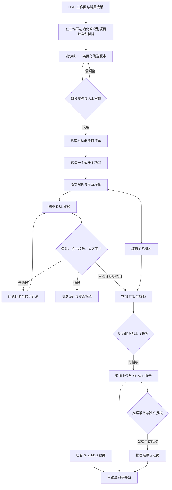
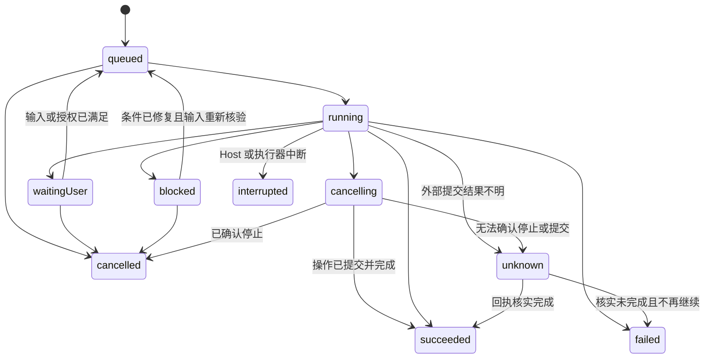
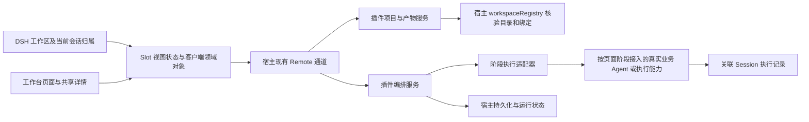

# 三条流水线集成方案

## 摘要

将“文档条目化、单功能 DSL 建模、本体关系管理”整合为 DSH 右侧栏内的“需求建模工作台”。采用一个 DSH 工作区对应一个建模项目：项目根目录直接使用工作区目录，工作台跟随当前会话所属工作区。用户在该项目内完成材料准备、功能拆分审核、逐功能建模、成果检查和图谱操作；主聊天区负责自然语言补充与 Agent 执行记录，工作台负责结构化配置、进度、审核和产物导航。

本文定义目标行为，不表示插件已具备全部能力。实施按[分阶段计划](剩余任务分阶段实施计划.md)逐页接通真实业务，以页面、实际执行和产物共同验收；真实执行器及所需业务实现纳入对应页面阶段。阶段 1–2 已通过，后续业务阶段尚未开始。

## 目录

- [1. 阅读顺序与设计依据](#1-阅读顺序与设计依据)
- [2. 范围与产品决策](#2-范围与产品决策)
- [3. 信息架构](#3-信息架构)
- [4. 手册场景覆盖](#4-手册场景覆盖)
- [5. 整体流程编排](#5-整体流程编排)
- [6. 状态与恢复](#6-状态与恢复)
- [7. 项目、版本和产物](#7-项目版本和产物)
- [8. 插件与宿主集成](#8-插件与宿主集成)
- [9. 实施边界与待核验项](#9-实施边界与待核验项)

## 1. 阅读顺序与设计依据

Agent 先读[分阶段实施计划](剩余任务分阶段实施计划.md)，再阅读本文、[界面与交互规范](三条流水线-界面与交互规范.md)及[Agent 实施任务书](三条流水线-Agent实施任务书.md)。完成状态必须依据实际证据及人工审核，不得依据设计描述判定。

| 依据 | 已核实内容 | 使用方式 |
|---|---|---|
| [使用手册](使用手册.pdf)，PDF 第 1–13 页 | 三条流水线、10 个场景、产物、交接条件、GraphDB 操作限制 | 业务事实依据；页码按 PDF 物理页计 |
| [现有产品提纲](../WorkBench%20Sidebar.md) | 建模流程、模型编辑、测试用例、知识图谱四个方向 | 保留其组织意图，补足页面和交互 |
| [插件入口](../src/client/index.ts)、[页面定义](../src/client/components/definition.ts) | 注册右侧栏正文、标题、开始页入口；注册随插件卸载释放 | 延续已有扩展点 |
| [现有页面](../src/client/app/Workbench.tsx)、[Host 入口](../src/index.ts) | 已有成果与限制见[接入核验](接入核验.md)及[阶段报告](阶段验收/阶段02-T01.md) | 复用已有实现；真实业务能力逐阶段核验 |
| [包声明](../package.json) | 包名是 `dsh-plugin-sidebar-workbench`；兼容声明为 DSH `0.2.1-rc.3` | 用户所称 `@dsh-sidebar-workbench` 指本插件，不据此重命名 npm 包 |
| [DSH 架构](../../deepseek-harness/docs/architecture.md)、[客户端约束](../../deepseek-harness/packages/client/AGENTS.md) | Cordis 扩展、Slot、数据层、模型可见内容记录规则 | 宿主集成约束 |
| [Workspace 定义](../../deepseek-harness/packages/workspace/workspace/src/types.ts)、[会话创建](../../deepseek-harness/packages/api/session-controller/src/commands.ts)、[工作目录机制](../../deepseek-harness/docs/subsystems/working-directory.md) | 工作区稳定 ID 与固定目录、会话原始目录校验、当前工作目录与项目归属分离 | 工作区绑定依据；源码核对不等于插件集成已验证 |

手册描述的是 QwenPaw 的使用方法。`requirement_itemizer`、`requirement_document_parse`、`requirement_analysis_pipeline`、`requirement_ontology_manager` 和 `ontologyAgent` 在本方案中是待映射的业务角色名称，不能认定为当前 DSH 已安装或可调用的工具。手册提到的“三份阶段映射”没有在正文完整列出三个文件名；本方案只固定明确写出的 `requirement_dsl_map.json` 和 `requirement_testcase_map.json`，其余由真实能力接入时确认。

## 2. 范围与产品决策

### 2.1 交付目标

用户无需记忆入口 Agent 名或复制长提示词，即可明确“当前项目、当前版本、当前功能、下一步操作、阻塞原因和成果位置”。所有操作都能回到对应运行记录、输入版本和产物；原文事实与推理结论始终可区分。

本计划覆盖页面交互、编排与 Host 数据能力，以及条目化、原文解析、DSL 生成/修订、测试生成、TTL 和 GraphDB 业务的真实接入及必要实现。具体先后与通过标准仅维护在[分阶段实施计划](剩余任务分阶段实施计划.md#1-依据与范围)。

完整可视化模型编辑器、Excel 编辑器、通用 DAG 编辑器和自动 MinerU 转换不属于本轮必需交付；生产部署与性能专项不由页面验收自动触发。

### 2.2 固定决策

1. 一个原生工作台入口，保留 `WORKBENCH_ID` 和 `WORKBENCH_KIND`；中文显示名改为“需求建模工作台”，英文为“Requirements workbench”。保留宿主右侧栏的分栏、浮动、关闭机制。
2. 页内采用“建模流程、模型、测试用例、知识图谱”四个一级视图。运行记录、产物、建模设置是共享辅助视图，不建立第二套宿主侧栏。
3. 三条流水线是预定义业务流程。首版使用步骤条、运行队列和检查项，不提供通用拖拽 DAG 编辑器。
4. 一个 DSH 工作区初始化后对应一个建模项目，项目根目录等于 `Workspace.path`。未初始化的工作区没有建模项目；不提供独立项目选择器、第二个项目根目录或同工作区多项目功能。Session 是执行记录与对话归属单位，关闭页面不取消 Host 中已启动任务。
5. 默认从单个功能顺序执行起步；批量队列的并发数由 Host 配置和能力上限控制。不得把浏览器定时器或持续对话轮询用作任务调度器。
6. 原始文档和需求 Markdown 保持只读。修订建议、划分意见和模型草稿均作为独立版本或输入提交。
7. GraphDB 本地校验、追加上传、推理、只读查询是四个独立动作；普通建模及“一键运行”不包含上传或推理。

### 2.3 工作区与项目绑定规则

DSH 是工作区 ID、规范化目录、显示名称和会话归属的唯一管理方。插件在该工作区上增加建模数据，不建立第二套目录注册表。工作区显示名称直接用于工作台项目标题，重命名经宿主已有能力完成；业务版本、功能和运行记录由插件管理。

| 约束 | 执行规则 |
|---|---|
| 一对一 | 同一 Host 数据域内，一个 `workspaceId` 最多绑定一个 `projectId`，一个 `projectId` 最多有一个有效工作区绑定；Host 对初始化和重新关联做唯一性检查 |
| 项目身份 | `projectId` 是插件生成的稳定标识，保存在项目根目录的 `.workbench/project.json`；不以工作区名称或路径字符串生成身份 |
| 根目录 | 从工作区登记记录解析 `projectRoot = Workspace.path`；表单只读展示，不接受用户另填的项目根目录或任意外部输出目录 |
| 会话跟随 | 通过宿主当前 Session 与工作区成员关系确定项目；工作区列表尚未同步时等待，无归属时提示前往 DSH 选择工作区，不回退到“最近项目” |
| 子目录 | 功能目录与运行输出目录仅为同一项目的资源位置，不自动创建子项目或子工作区；不通过路径前缀推断 Session 归属 |
| 同项目多会话 | 同一工作区下的会话共享项目事实；选中功能、筛选、草稿按会话/pane 隔离，任务保持原执行所有权 |
| 绑定核对 | 初始化和重新关联时比对工作区规范化路径、项目标识及有效绑定；复制目录造成相同 `projectId` 时报告冲突，不自动接管或合并 |

当前 DSH 的 `Workspace.path` 是创建时经 `realpath` 解析的固定目录；Session 创建接口可接受 `workspaceId`，以该工作区目录初始化会话并关联。成员校验要求 `Session.header.cwd` 规范化后与工作区目录相等，而非任意后代目录。Session 后续改变当前工作目录，不改变工作区归属、原始项目目录或沙盒写入范围。

这些规则用于插件集成设计，不要求修改 DSH 的 Workspace 数据结构。宿主工作区创建、改名、移除通过已有服务完成，业务元数据放入插件自己的持久化域。

## 3. 信息架构

```text
DSH 现有外壳
├─ 工作区导航：选择目录 / 管理工作区 / 打开所属会话
├─ 主聊天区：补充要求、关联运行、查看 Agent 对话
└─ 右侧栏 > 需求建模工作台
   ├─ 工作区与版本栏：当前工作区名称 / 只读根目录详情 / 当前版本 / 建模设置
   ├─ 建模流程
   │  ├─ 项目概览与材料准备
   │  ├─ 01 文档条目化：新建 / 新版本比较 / 划分审核
   │  ├─ 02 单功能建模：功能列表 / 功能详情 / 批量队列
   │  └─ 03 本体关系管理：操作入口 / 前置条件 / 最近结果
   ├─ 模型：功能选择 / 原文与模型 / 对齐问题 / 修订记录
   ├─ 测试用例：功能选择 / 用例预览 / 覆盖映射 / 导出
   ├─ 知识图谱：范围选择 / 关系列表或图 / 证据 / 远端操作
   └─ 共享详情：运行记录、产物预览、版本差异、操作确认
```

“建模流程”负责发起和推进；“模型、测试用例、知识图谱”负责检查产物和局部重跑。两种入口打开同一个运行、同一组产物，不维护重复任务状态。项目概览提供最近运行、阻塞项、待审核项以及明确的“下一步”按钮；不按对话条数估算业务进度。

当前会话无工作区归属时显示“前往 DSH 选择工作区”。有工作区但没有建模项目时显示“在当前工作区初始化”和“识别当前目录已有成果”。识别过程只读扫描，确认后才保存插件元数据；缺少文件、格式未知或校验报告缺失时显示“待校验”，不能直接进入全部通过状态。要使用其他目录中的已有项目，先通过 DSH 将该目录登记为工作区并打开其会话，再进入工作台。

## 4. 手册场景覆盖

本表是业务范围的唯一索引。`S01`–`S10` 用于实施和验收，不作为产品界面文案。

| 编号与手册位置 | 工作台入口 | 用户操作与交接结果 |
|---|---|---|
| S01 首次条目化，第 2–3 页 | 建模流程 → 文档条目化 → 首次处理 | 在当前工作区初始化项目，选择原始 DOCX/PDF 与同版本 MinerU Markdown；根目录继承工作区，输出位于其内部；生成候选条目和校验结果，审核后采用 |
| S02 文档更新，第 3–4 页 | 项目版本 → 导入新版本 | 输出新增、删除、改名、需重新建模的差异；旧版本保持可读；人工确认匹配与采用范围后生成新基线 |
| S03 完整功能建模，第 4–7 页 | 单功能建模 → 选中功能 → 完整建模 | 原文解析 → 四类 DSL → 对齐及语法/统一校验 → 测试设计；显示阶段产物、覆盖与阻塞；支持受控批量队列 |
| S04 关系遗漏，第 7 页 | 功能详情 → 检查关系遗漏 | 定位原文证据和 `relation_delta.json`；待确认关系独立列出；需修订模型时进入对应建模运行 |
| S05 DSL 问题，第 7–8 页 | 模型 → 问题 → 对齐与复验 | 显示错误位置、修订依据、`completion_plan.md` 与复验结果；不以删除条件换取通过 |
| S06 仅重生测试，第 8 页 | 测试用例 → 重新生成 | 复核当前 DSL 版本的语法、统一校验和对齐硬门禁；存在 partial、missing 或未覆盖断言时阻止正式生成 |
| S07 本地 TTL，第 8–9 页 | 本体关系管理 → 本地校验 | 对已验证 DSL 与项目关系生成 ABox TTL、统计和本地校验报告；不连接 GraphDB |
| S08 上传，第 9–10 页 | 知识图谱 → 追加上传 | 展示目标地址/仓库、TTL 版本、数量及范围；取得明确授权后仅追加 ABox；返回上传与 SHACL 结果 |
| S09 推理，第 10 页 | 知识图谱 → 依赖与冲突分析 | 确认 ABox/TBox/SHACL 就绪和当前仓库；单独授权；展示数据依赖、写冲突、状态机问题及证据 |
| S10 查询/导出，第 10–11 页 | 知识图谱 → 查询已有关系 | 选择功能与关系类型，只读查询；导出类型、起点、终点、证据和置信度及统计；无置信度时显示“未提供” |

## 5. 整体流程编排

### 5.1 主流程与产物交接



测试用例生成与本地 TTL 是通过模型校验后的两个成果分支。项目最终交付检查仍遵循手册第 11 页：核对 DSL、映射、测试用例和项目关系；本地 TTL 可显式选择已验证的功能子集，但必须显示“部分项目”，列出未纳入项，不能展示为全项目完成。只读查询已有图谱不要求重新运行前两条流水线。

### 5.2 流水线定义

| 流水线 | 编排阶段 | 停止条件 | 可见完成条件 |
|---|---|---|---|
| 文档条目化 | 材料检查 → 条目化 → 完整性与关系证据检查 → 划分审核 → 采用版本 | 材料不可读、版本待确认、条目/概述缺失、证据不完整 | 运行完成与版本已采用分别显示；审核通过才允许成为后续输入 |
| 单功能建模 | 输入快照 → 原文解析 → DSL 建模 → 对齐/复验 → 测试设计 → 产物检查 | 语法/统一校验失败、partial/missing、断言未覆盖、必需产物缺失 | 所选操作的全部阶段完成；测试路径必须有用例及追溯映射 |
| 本体关系管理 | 选择操作与范围 → 前置检查 → 必要授权 → 执行 → 结果核对 | 校验失败、无有效授权、准备不足或外部结果未知 | 按本地校验、上传、推理、查询分别报告，不合并为一个绿色状态 |

每次运行记录固定的 `operation`，例如“完整建模”“检查关系”“对齐复验”“仅生成测试”。局部重跑只复用内容指纹和校验依据仍匹配的产物；运行图显式标注“复用已验证结果”或“不适用”，不能将未执行阶段标成刚刚成功。

### 5.3 批量编排与项目关系合并

功能条目是批量任务的最小独立单位。用户在选择清单中看到数量、输入版本、预计产物和当前可运行项；不可运行项保留原因，不能静默跳过。一个功能失败不取消其他独立功能，但依赖该功能产物的阶段停止。

每个功能产生自身关系增量；Host 对项目级关系版本进行串行提交，使用预期版本检查避免多任务互相覆盖。版本冲突或需要人工确认的关系进入待处理清单。并行任务不能同时直接覆盖 `requirement_relations.json`。具体合并与证据判定算法留待业务设计。

批次汇总显示“已完成 / 运行中 / 待审核 / 阻塞 / 失败 / 已取消”的数量。底部运行摘要持续可见；用户可以离开页面，重新打开后按运行 ID 恢复显示。真实执行器不能承诺脱离 Session 独立存活时，UI 必须标明依赖，并在 Session 结束或子任务取消后同步实际结果。

### 5.4 版本更新与影响范围

新版本条目化先写候选产物和差异报告。审核页包含新增、删除、改名、内容变化、关系变化、需人工匹配六类；重命名不能仅凭名称相似自动确认。采用后切换项目基线，旧版本和已交付产物仍可查阅。

受影响功能的 DSL、对齐结果、测试用例以及引用它们的 TTL 标记为“需更新”。无可靠影响分析时采用保守范围并说明原因；该判定由版本差异阶段接入的业务能力提供。已上传远端数据保持原样，显示“远端版本落后”，不自动删除、替换或重复上传旧三元组。

### 5.5 GraphDB 操作授权

本地 TTL 操作不触发网络访问。查询/导出默认只读。追加上传与推理需要绑定具体操作、目标地址、仓库、项目版本、产物指纹和范围的授权记录，由 Host 在执行前校验；凭据通过宿主凭据能力持有，页面只显示连接别名及脱敏状态。

用户在“追加上传”确认页批准的本次操作不得再要求同范围的重复确认。授权不自动扩展至后续版本、其他仓库、推理、清库或覆盖 TBox/SHACL。目标或输入发生变化时使旧授权失效并返回确认页。

首版不提供清库、仓库重建、覆盖 TBox/SHACL 按钮。上传成功与 SHACL 通过分别记录；已提交后验证失败时保留提交事实，阻止依赖该验证的后续动作，不宣称回滚。上传中网络中断可能产生未知结果，必须核对回执和目标状态后再决定重试。

## 6. 状态与恢复

### 6.1 分开记录执行、校验、审核和新鲜度

| 维度 | 建议值 | 语义 |
|---|---|---|
| 执行状态 | `queued / running / waiting-user / blocked / cancelling / succeeded / failed / cancelled / interrupted / unknown` | 运行是否开始、推进、停止或结果待核实 |
| 校验状态 | `not-checked / passed / failed / not-applicable` | 绑定明确输入/产物版本和校验器版本，不由退出码代替 |
| 审核状态 | `not-required / pending / accepted / rejected` | 人工是否采用候选结果；不能覆盖机器校验失败 |
| 产物新鲜度 | `current / stale / unknown` | 对当前输入版本是否仍有效 |

`succeeded` 表示本次选择的操作已完成并登记必要产物，不表示全项目完成；条目化运行可以 succeeded、审核 pending。业务前置条件由以上维度共同计算，不能使用单一 `isDone` 布尔值。进度显示完成阶段数及批次计数；无可信工作量时显示当前阶段和耗时，不制造线性百分比或剩余时间。



图中的 `waitingUser` 对应数据值 `waiting-user`。`interrupted` 和 `unknown` 都不能直接自动重新提交；恢复检查先判断哪些结果已提交、哪些需人工处理。失败、取消或中断后的重试创建新 attempt 并保留原记录，复用经过验证的输入与产物。

### 6.2 失败责任与可恢复行为

| 情况 | 处理责任 | 页面反馈与安全后续 |
|---|---|---|
| 源文件缺失、同版本未确认 | Host 输入检查；用户修正材料 | 字段旁显示问题；不创建已开始执行的假记录 |
| 业务校验失败 | 业务适配器提供结构化问题；编排器阻断依赖 | 保留已有产物；提供查看问题、补充信息、局部重跑 |
| 重复点击启动、客户端请求超时 | Host 使用请求幂等键返回同一运行 | 重查该运行；不再次生成独立任务 |
| 连接断开 | Client 数据层重连并获取权威快照 | 保留上次结果，显示“连接中断，状态待同步”；不据此标记任务失败 |
| 用户取消 | Host 停止排队及请求执行器取消 | 显示“正在取消”，收到确认后才显示“已取消”；保留已提交成果 |
| Host 重启或插件卸载 | Host 执行所有者停止接单、协调取消并记录结果 | 重启后核对未终结任务；不能假装仍在运行或自动重发写操作 |
| 外部写入结果未知 | GraphDB 适配器核对；编排器冻结依赖 | 持续显示“上传结果待核实”，提供核对入口；禁止盲目重试 |
| 客户端视图被关闭 | Client 清理视图订阅；Host 保留运行所有权 | 不取消任务；运行记录可重新进入 |
| 工作区被移除、目录丢失或绑定冲突 | Host 项目服务核对绑定；编排器阻止新运行和下一阶段 | 保留项目文件与历史；当前阶段按执行器实际结果收尾，不能静默改用其他目录；详见 7.4 |

短暂操作结果使用宿主全局 Toast；持久阻塞、断连和结果未知必须在页面与运行详情持续可见。错误包含受影响操作、原因摘要、可行下一步；原始日志折叠展示并脱敏。清理顺序应保留执行器依赖直到消费者结束，具体生命周期实现遵守 Cordis 规范。

## 7. 项目、版本和产物

### 7.1 最小概念模型

这些名称是建议的插件内部领域概念，不是已存在的 DSH API，也不要求立刻创建同名数据库表。

| 对象 | 最小信息 | 归属 |
|---|---|---|
| Workspace | `workspaceId`、规范化 `path`、显示名称、会话成员 | DSH 宿主服务；插件只消费权威记录 |
| Project | `projectId`、schema 版本、材料引用、当前基线 | 插件项目服务；项目标题跟随工作区，根目录由绑定解析 |
| WorkspaceBinding | 当前 Host 数据域的 `workspaceId ↔ projectId`、绑定修订号、核对路径及绑定状态 | 插件 Host 持久化域；核对路径不是可编辑根目录 |
| SourceRevision | 原始文档与 Markdown 引用、指纹、版本声明及核验状态 | Host 项目服务 |
| Feature | 稳定标识、名称、来源章节、条目引用、所属基线 | Host 项目服务；名称不是标识 |
| Run / StageRun | `workspaceId`、`projectId`、绑定修订号、根目录与输出位置快照、操作、输入版本、功能范围、attempt、状态、执行引用 | Host 编排服务；已创建运行的目录和归属不可随导航改变 |
| Artifact | 类型、资源引用、内容指纹、生产运行、来源版本、校验摘要 | Host 产物索引；文件内容仍在产物存储中 |
| Review | 审核对象及版本、结论、意见、时间 | Host 项目服务 |
| Authorization | 操作、目标、范围、输入指纹、授权记录、使用情况 | Host 操作服务；不能只存于按钮状态 |
| ViewState | 当前页、功能、筛选、展开项、未提交草稿 | 声明在 Slot 的视图 store，按 Session/pane/project 隔离；不保存独立项目选择或覆盖宿主归属 |

跨进程标识使用品牌类型；wire 和文件输入做结构校验。Host 通过 `workspaceId` 查找有效工作区，校验用户访问权限、目录状态和项目绑定后解析根目录，不信任 Client 提交的路径。浏览器与 Host 不一定在同一机器；拖放文件只能作为明确的材料导入，不能当作 Host 绝对路径。

### 7.2 产物索引

| 范围 | 手册明确的产物 | UI 展示 |
|---|---|---|
| 项目条目化 | 功能概述 Markdown、系统概述、`chunks.json`、`project_relation_seed`、功能 Markdown、校验结果 | 条目表、来源位置、关系证据、差异审核 |
| 功能解析 | `requirements.json`、实体表、if-then、`relation_delta.json` | 原子需求和实体表、条件摘要、关系增量 |
| 功能模型 | Environment、ExternalScenario、Statechart、DialogMap、`requirement_dsl_map.json` | 四类模型导航、只读源码/可用预览、原文定位 |
| 功能对齐 | `alignment_result.json`、`alignment_report.md`、`completion_plan.md`、`alignment_changes.md` | 问题列表、覆盖状态、修订依据与复验 |
| 功能测试 | `testcase/测试用例.xlsx`、`requirement_testcase_map.json` | 测试用例预览、断言、需求与 DSL 追溯 |
| 项目关系 | `requirement_relations.json` | 原文关系及证据；区别于本体推理关系 |
| 图谱成果 | ABox TTL、转换统计、本地校验、上传/SHACL/推理报告、关系导出 | 文件入口、统计、问题、目标仓库及版本 |

手册对测试映射位置存在简写，第 8 页明确使用 `testcase/requirement_testcase_map.json`，新增产物以此作为默认约定。已有项目以导入清单登记的实际路径为准；不能靠同名猜测静默选文件。关系种子、实体表、if-then、DSL 和部分报告未给出唯一文件名，使用产物类型与清单绑定，不臆造固定扩展名。

### 7.3 版本保存规则

项目根目录固定为 DSH 工作区根目录。源文件不移动、不修改；新增产物写入根目录下的独立运行输出位置，登记后再采用为项目有效版本。下列业务子目录为推荐布局，已有成果保留原布局并按清单索引，不强制搬迁；根目录继承、一项目一份身份清单及运行隔离是固定约束。

```text
<DSH Workspace.path>/          即 projectRoot
  sources/                    导入的原始文档与同版本 Markdown
  chunks.json                 已有项目可保持原位置
  requirement_relations.json  已有项目可保持原位置
  features/                   功能条目、DSL、对齐与测试成果
  ontology/                   TTL 与图谱报告
  .workbench/project.json     项目身份、schema、材料与有效基线引用
  workbench-runs/<run-id>/     新运行隔离输出
```

项目清单是 `projectId`、材料引用与有效基线引用的持久化来源；Host 通过插件项目服务原子更新并发布，文件被外部修改后必须重新核验。工作区绑定、运行状态和输入快照存入宿主的插件非 Session 持久化域；产物索引可由清单和运行记录恢复，不能成为另一份可独立编辑的基线。初始化重复请求返回同一项目，清单已写入而绑定保存失败时进入待核对状态，不另生成项目身份。

浏览器草稿不是业务数据备份，不得将项目事实整份复制到 localStorage 或每个 Session 中。正式产物存在但索引登记失败时记录待核对状态；索引存在但文件缺失时停止消费。导入或恢复目录可以找回已保存业务成果，不能承诺仅凭目录恢复全部宿主运行历史。

所有新业务输出必须位于所属工作区内。Host 以规范化路径及实际资源权限检查目标，防止 `..`、符号链接或 junction 将写入导向其他目录；工作区绑定本身不授予额外文件权限。工作区外的材料只在明确且获准的只读引用或显式复制导入下使用，原件不改；首版不支持外部输出目录。

### 7.4 工作区生命周期与重新关联

| 变化 | 插件行为 |
|---|---|
| 同工作区切换会话 | 展示同一项目及成果，恢复各自视图状态；不重复初始化 |
| 切换到另一工作区的会话 | 工作台切到目标项目或初始化页，原任务继续使用启动快照；旧异步响应不得覆盖目标页面 |
| 工作区改名 | 标题跟随宿主，项目 ID、根目录、历史和运行不变 |
| 工作区登记被移除 | 保留文件和业务记录，绑定标为已解除；禁止新运行及调度下一阶段；已执行阶段可收尾，无法核实的外部提交保持 unknown |
| 目录缺失或不可访问 | 不创建替代目录、不回退到进程 cwd；阻止新阶段，保留历史并提示恢复目录或重新关联 |
| 原目录重新登记 | 新 `workspaceId` 不自动继承旧绑定；核对 `.workbench/project.json`、目录、有效绑定与未终结任务后显式重新关联 |
| 项目目录迁移 | 先停止并核对旧运行，再在 DSH 登记新目录并关联同一项目；新运行使用新目录，旧记录保留旧快照，旧会话不自动转移 |
| 复制目录出现同一项目 ID | 提示身份冲突，禁止两个有效工作区共同写同一项目；复制为独立新项目的功能不在首版范围 |

移除 DSH 工作区只移除注册，不作为删除文件的授权。插件的重新关联只改变业务绑定，不能修改既有 Session 的不可变原始目录。重新关联前必须确认旧绑定无可继续写入的运行；结果未知时先核对，不靠解除绑定掩盖任务状态。首次初始化不扫描或合并其他已登记工作区的项目清单；发现同目录范围有嵌套建模项目时提示单独选择其根目录，避免父子项目共享产物。

## 8. 插件与宿主集成

### 8.1 职责分配



Client 只展示数据并发出明确命令；Host 校验范围、创建运行、协调阶段、持久化状态和核对产物。模型调用和工具执行继续使用 DSH 已有能力，不改 `agent-loop`，不让 React 直接调用 GraphDB 或启动子进程。

复用宿主工作区能力：Host 从 `ctx.workspaceRegistry` 读取登记记录，Client 通过已声明的注入与框架 hooks 消费 `workspaces` 的权威视图；工作区创建、改名和移除使用宿主已有通道。插件补充初始化、识别、绑定核验与重新关联操作，不复制工作区列表。实际依赖声明、派生 props 和 Remote 接入仍需 T00 做最小集成验证。

首阶段保留单包结构，内部区分领域类型、Client、Host 和执行适配器。Service Definition 声明输入输出与失败语义，Service Provider 负责运行及持久化，Client/Remote Consumer 发起操作并消费结果。三者在同一插件内可以协同交付，不为目录整齐提前拆多个 npm 包。

### 8.2 最小执行协议

UI 和编排器需要的适配信息仅限：能力可用性、支持的操作、前置条件、阶段计划、启动回执、状态更新、产物清单、结构化问题、取消回执及恢复核对能力。本方案不定义业务请求 Prompt、工具参数、模型选择或算法实现。

每次启动携带 `workspaceId`、`projectId`、绑定修订号、版本引用、功能范围、操作类型、输入产物引用、用户限制、幂等键和必要授权引用。Host 重新核验绑定并生成不可变的根目录、输入和输出位置快照；客户端导航或当前工作目录变化不能改写这些快照。每个阶段开始前检查绑定、资源访问与输入有效性，不能只在点击启动时检查一次。

执行返回稳定运行/阶段标识，状态按单调序号发布；重连先获取快照再接续更新，旧序号不得覆盖新状态。最终成功必须来自已核验的阶段结果及产物清单，不从聊天文本中的“完成”提取。

无执行器时生产页显示“执行能力未接入”，禁用执行并说明原因；开发/测试可以使用显式 demo 模式。demo 与真实项目隔离，所有模拟产物和进度标明“演示数据”，不访问文件系统、模型或 GraphDB。

### 8.3 Session 与聊天协作

工作台通过当前 Session 的宿主工作区归属解析唯一项目，不允许在该会话内另选一个无关项目。多个同工作区 Session 可打开同一项目。一个 Run 可关联主执行 Session 和多个子任务引用；会话或工作区导航不转移任务所有权。跳转关联对话时同步切换其项目上下文，不能在工作区 B 的会话里提交工作区 A 的运行补充要求。

需要新执行会话时，通过宿主 Session 创建能力传入目标 `workspaceId`，不要同时传 `cwd`；以工作区根目录建立会话，再用明确的功能资源引用和受控执行目录处理子目录。不能先以功能子目录创建普通会话，再强行附加到根工作区。委派子任务需验证继承的根目录、权限和运行关联，不假设所有子任务都会作为普通会话显示在左栏。

执行器使用 Run 固定的目录上下文；不得通过并发修改同一聊天 Session 的当前工作目录来调度多个功能。确需使用可变当前目录的执行器，应使用隔离执行会话并在接入时验证目录行为。Session 内的 `cd` 不改变项目绑定，也不改变沙盒根目录；插件自身的 Host 文件操作同样需要实际资源权限检查。

工作台的“补充要求”提交到明确的运行/功能范围，发往模型的内容必须经宿主记录为可重建的 Session 输入。草稿尚未提交时只属于视图。模型输出、工具结果和 UI 状态通过运行标识关联，避免将业务状态写回对话作为第二个权威来源。若新增 Session 事件或投影，必须遵守持久化类型声明、投影生命周期及两套 SDK 的检查要求。

## 9. 实施边界与待核验项

| 待核验项 | 默认处理 | 影响阶段 |
|---|---|---|
| 原业务 Agent/Skill 的实际存放位置和 DSH 调用方式 | 阶段 3 核验源包、入口、配置与格式；对应阶段接通前不可验收，不猜测可执行名称 | 真实执行器接入 |
| 未具名阶段映射、报告及 DSL 的真实格式 | 以产物清单适配，未知文件只读展示 | 产物预览深化 |
| DSH 当前 Remote、资源预览、执行/后台任务及存储 API | 实施前阅读当前源码并做最小验证；只使用公开扩展点 | Host 编排 |
| 右侧栏 Slot 的 Session/pane 标识与 store 持久化方式 | 使用框架派生 props；不得自行读内部 dockkit 数据 | 页面状态 |
| 工作区跟随、唯一绑定、目录生命周期的真实接入 | 按 2.3、7.4 与 8.3 固定规则核验现有服务；不另建项目选择器，不开放自定义根目录 | T00、T01、T04 |
| 项目完整导入、稳定功能 ID 与影响分析 | 采用待校验状态和人工差异匹配 | 版本管理 |
| GraphDB 追加的幂等性、项目隔离、事务与查询范围 | 接入前验证并补充专项协议；未知结果停止自动重试 | 图谱写入 |
| Excel、图结构、DSL 的预览能力 | 首版提供列表、文本和打开产物；专用预览作为增量 | 成果视图 |

上述事项属于对应页面阶段的前置核验；必需能力缺失时该阶段阻塞、未通过，不能用模拟编排代替。执行顺序、范围和审核标准以[分阶段实施计划](剩余任务分阶段实施计划.md)为准，原 T 编号仅保留职责分类。完整模型编辑器仍属于后续增强能力。
